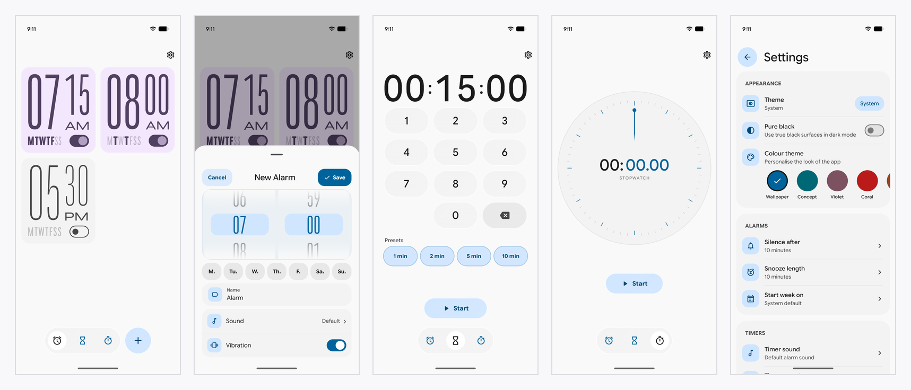

# Expressive Clock

*A Material 3 Expressive clock app for Android.*

Expressive Clock is a personal evolution of [Material Clock](https://github.com/rbouaf/material-clock), an open-source Android clock project created by [Rayane Bouafia (@rbouaf)](https://github.com/rbouaf). Huge thanks to the original developer for sharing the project and making this work possible.

Building on that foundation, Expressive Clock brings together alarms, a world clock, timers and a stopwatch in a modern Android interface inspired by Google's Material 3 Expressive design language.

## Features

- **Alarms:** Schedule alarms with ringing and snooze functionality.
- **World Clock:** View the time across different locations.
- **Timers:** Create and manage countdown timers.
- **Stopwatch:** Track elapsed time.
- **Analog clock widget:** A configurable home-screen clock widget.
- **Expressive design:** Material 3 Expressive styling, Google Sans Flex typography and carefully crafted animations.

Features and behaviour may evolve as the project develops.

## Building from source

Expressive Clock is an Android application built with Kotlin and Jetpack Compose.

1. Clone this repository.
2. Open the project in Android Studio.
3. Allow Gradle to sync and download the required dependencies.
4. Build and run the app on a compatible Android device or emulator.

You can also use the included Gradle wrapper to build the project from the command line.

## Acknowledgements

Expressive Clock builds upon the open-source work of [Rayane Bouafia](https://github.com/rbouaf) and the original [Material Clock repository](https://github.com/rbouaf/material-clock).

This fork preserves the original project's licensing and attribution while developing the application further under the Expressive Clock name.

## Licence

The project's original source code is licensed under the MIT Licence. See [LICENSE](LICENSE) for the full licence text.

Bundled font files are licensed separately under the SIL Open Font License 1.1. See [THIRD-PARTY-NOTICES.md](THIRD-PARTY-NOTICES.md) and the files in the `licenses/` directory for details.

Google, Google Sans, Material, Android and Pixel are trademarks of Google LLC. Expressive Clock is an independent project and is not affiliated with, sponsored by or endorsed by Google.